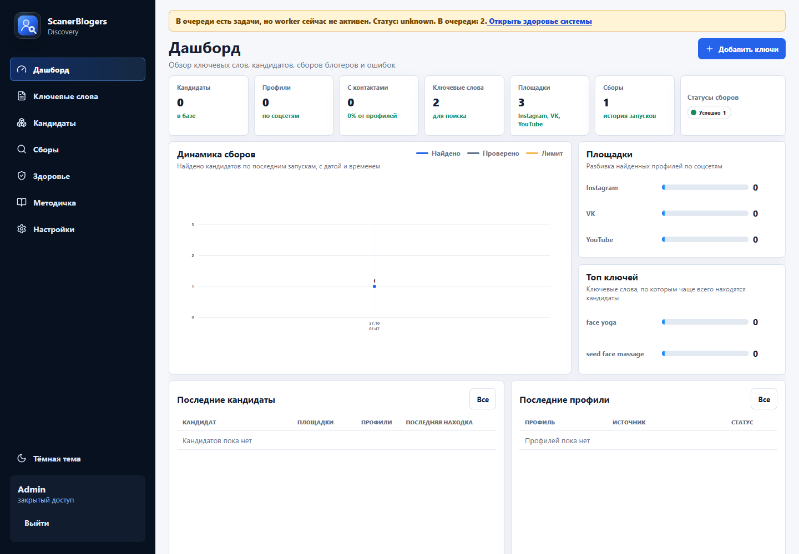

# ScanerBlogers

Сервис для поиска и отбора блогеров в Instagram, VK и YouTube. Веб-интерфейс управляет ключевыми словами, заданиями сбора, карточками кандидатов и экспортом. Отдельный воркер выполняет задания и сохраняет результаты в SQLite.



## Что умеет

- Поиск по словам и хэштегам, фильтры по площадке, стране и числу подписчиков.
- Карточки кандидатов с контактами, метриками, источником обнаружения и статусом обработки.
- Очередь с ограничением параллельных заданий, отменой, историей запусков и событиями диагностики.
- Управление доступами к площадкам, проверка подключений и учёт временных блокировок.
- Выгрузка выбранных кандидатов в CSV и XLSX, отметка экспортированных записей.
- Экран состояния воркера, подключений и заданий.

В проекте также сохранён модуль мониторинга рекламных объявлений Google Ads Transparency с историей креативов и экспортом. Интерфейс закрыт авторизацией администратора.

## Стек и структура

TypeScript, Next.js, React, Prisma, SQLite, Node.js, Python, Playwright.

| Каталог | Ответственность |
| --- | --- |
| apps/web | Страницы, API, авторизация и действия пользователя |
| apps/worker | Очередь, запуск сборщиков, отмена и восстановление заданий |
| packages/core | Форматы данных, нормализация и общие правила |
| packages/db | Схема Prisma, миграции, запросы и хранение результатов |
| collectors | Сборщики Instagram, VK и YouTube на Python |
| chrome-extension* | Расширения для работы с браузером |
| vendor/instagram-instagrapi | Сторонняя библиотека, используемая сборщиком Instagram |
| tests | Интеграционные проверки и сценарии в браузере |

## Запуск

Нужны Node.js 24, npm, Python 3.11 или новее и Git. Для библиотек SQLite могут понадобиться средства сборки C++, если для системы нет готового бинарного пакета.

```powershell
npm ci
Copy-Item .env.example .env
```

В .env укажите свой ADMIN_EMAIL, отдельный ADMIN_PASSWORD и случайный AUTH_SECRET. Для генерации секрета можно выполнить команду `node -e "console.log(require('crypto').randomBytes(48).toString('hex'))"`. Примеры значений из файла нужно заменить перед запуском.

```powershell
npm run prisma:generate
npm run prisma:migrate:deploy
npm run build
npm run dev
```

Откройте http://localhost:3000. Команда dev запускает веб-интерфейс и воркер, читая локальные .env.local и .env. Для рабочего сбора настройте доступы к нужным площадкам. Сам по себе запуск интерфейса не создаёт эти доступы.

Python-зависимости установите из корня проекта в отдельное окружение.

```powershell
python -m venv .venv-instagram
.venv-instagram\Scripts\python -m pip install -r collectors/instagram/requirements.txt
npx playwright install chromium
```

На Linux исполняемый файл окружения находится в .venv-instagram/bin/python. Инструкция requirements.txt использует библиотеку из vendor и закреплённый коммит vk-api.

Для необязательного поиска YouTube через веб-страницы установите scrapetube в это же Python-окружение. Поиск через официальный YouTube API использует YOUTUBE_API_KEY.

Для продакшена запустите собранный веб-сервис и воркер отдельно. Передайте одинаковый DATABASE_URL и нужные переменные окружения обоим процессам. Сценарии portable и Docker включены в исходники, но готовые установочные пакеты и Docker-образ здесь не публикуются.

## Проверки

```powershell
npm run verify:secrets
npm run test:unit
npm run typecheck
npm run typecheck:qa
npm run verify:collectors
npm run build
npm run test:integration
npm run test:e2e
```

Интеграционные и браузерные проверки используют отдельные базы с test в имени, синтетические данные и подставные сборщики. Для test:e2e нужен Chromium Playwright. Можно указать PLAYWRIGHT_EXECUTABLE_PATH с путём к установленному Chrome. Команды verify:live и verify:full-live обращаются к внешним сервисам и требуют настроенных доступов.

## Данные и ограничения

Реальные сессии, cookies, API-ключи, прокси, профили браузера и рабочие базы не входят в репозиторий. Не публикуйте файлы .env, .instagram, .vk, .vk-browser, data и runtime. Перед публикацией изменений запускайте verify:secrets.

Доступность сбора зависит от API площадок, сессий, лимитов и изменений их интерфейсов. Поиск в SQLite через LIKE нечувствителен к регистру ASCII; для других алфавитов SQLite не обеспечивает полное Unicode-сравнение без дополнительных расширений.

Сторонняя instagrapi сохранена вместе с MIT-лицензией в vendor/instagram-instagrapi/LICENSE. Общая свободная лицензия на исходный код приложения не предоставлена.
